# п.1 
В среде Google Colab создали новый блокнот. Перешли в рабочую папку, где лежит блокнот

```py
import os
os.chdir('/content/drive/MyDrive/Colab Notebooks')
```

Импортировали необходимые для работы библиотеки и модули.
```py
from tensorflow import keras
import matplotlib.pyplot as plt
import numpy as np
import sklearn
```

# п.2 
Загрузили набор данных MNIST, содержащий размеченные изображения
рукописных цифр.

```py
from keras.datasets import mnist
(X_train, y_train), (X_test, y_test) = mnist.load_data()
```

# п.3 
Разбили набор данных на обучающие и тестовые данные в соотношении
60 000:10 000 элементов. При разбиении параметр random_state = № бригады (в нашем случае 7)

```py
# создание своего разбиения датасета
from sklearn.model_selection import train_test_split
# объединяем в один набор
X = np.concatenate((X_train, X_test))
y = np.concatenate((y_train, y_test))
# разбиваем по вариантам
X_train, X_test, y_train, y_test = train_test_split(X, y,
 test_size = 10000,
 train_size = 60000,
 random_state = 7)
```

Вывели размерности полученных обучающих и тестовых массивов данных.

```py
print('Shape of X train:', X_train.shape)
print('Shape of y train:', y_train.shape)

Вывод:
Shape of X train: (60000, 28, 28)
Shape of y train: (60000,)
```

# п.4 
Вывели первые 4 элемента обучающих данных (изображения и метки цифр).

```py
for i in range(4):
    plt.imshow(X_train[i], cmap='gray')
    plt.title(f'Label: {y_train[i]}')
    plt.axis('off')
    plt.show()
```
<p align="center">
    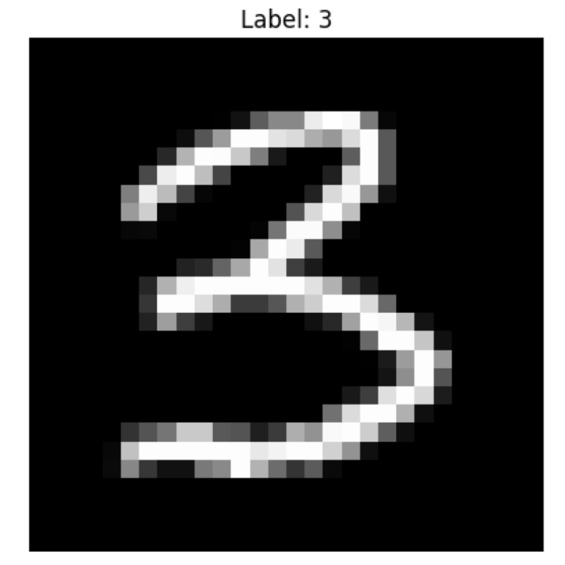
    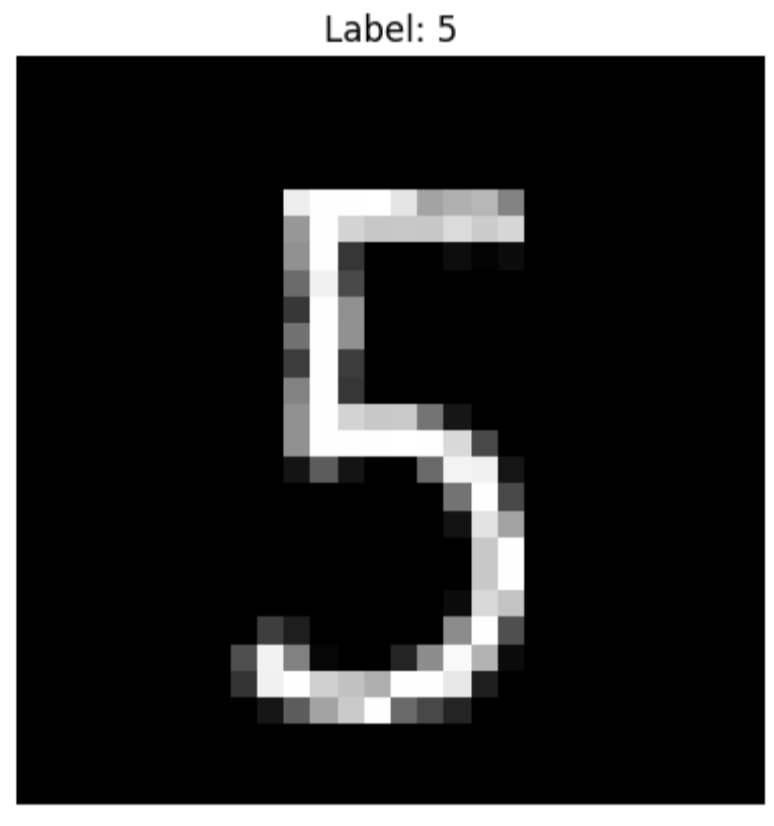
    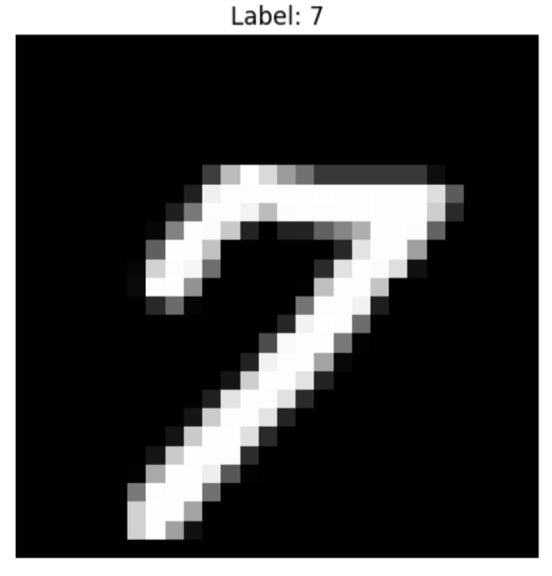
    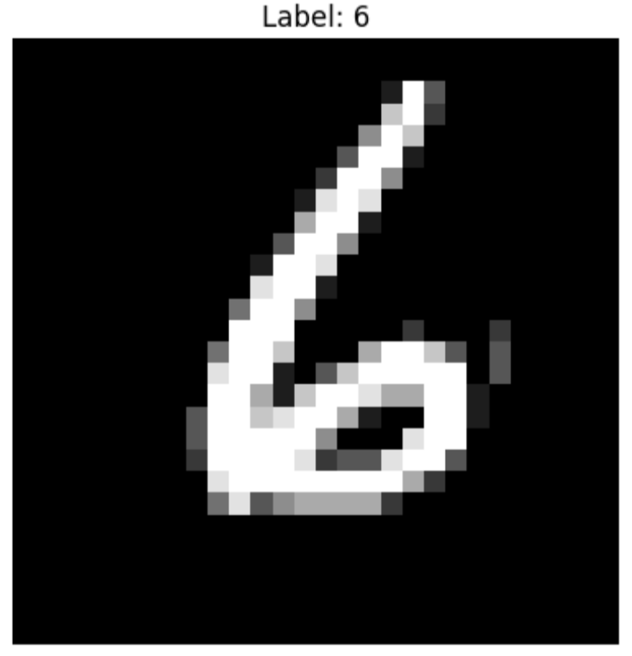
</p>


# п.5 
Провели предобработку данных: 
- привели обучающие и тестовые данные к формату, пригодному для обучения нейронной сети. 
- Входные данные привели к значениям от 0 до 1. Метки цифр закодировали по принципу «one-hot encoding».
- Вывели размерности предобработанных обучающих и тестовых массивов данных.

```py
# развернем каждое изображение 28*28 в вектор 784
num_pixels = X_train.shape[1] * X_train.shape[2]
X_train = X_train.reshape(X_train.shape[0], num_pixels) / 255
X_test = X_test.reshape(X_test.shape[0], num_pixels) / 255

print('Shape of transformed X_train:', X_train.shape)
print('Shape of transformed X_test :', X_test.shape)  

Вывод:
Shape of transformed X_train: (60000, 784)
Shape of transformed X_test : (10000, 784)
```

```py
# переведем метки в one-hot
#from keras.utils import np_utils
from keras.utils import to_categorical

y_train = to_categorical(y_train)
y_test = to_categorical(y_test)

print('Shape of transformed y train:', y_train.shape)
num_classes = y_train.shape[1]  

Вывод:
Shape of transformed y train: (60000, 10)
```

# п.6
- Реализовали модель однослойной нейронной сети и обучили её на обучающих данных с выделением части обучающих данных в качестве валидационных. 
- Вывели информацию об архитектуре нейронной сети. 
- Вывели график функции ошибки на обучающих и валидационных данных по эпохам.

При реализации модели нейронной сети использовали архитектуру и параметры обучения, указанные в задании.

```py
from keras.models import Sequential
from keras.layers import Dense

# 1. создаем модель - объявляем ее объектом класса Sequential
model = Sequential()
# 2. добавляем выходной слой (он же первый, поэтому указываем input_dim)
model.add(Dense(units=num_classes, input_dim=num_pixels, activation='softmax'))
# 3. компилируем модель
model.compile(loss='categorical_crossentropy', optimizer='sgd', metrics=['accuracy'])

# вывод информации об архитектуре модели
print(model.summary())
```
Вывод:
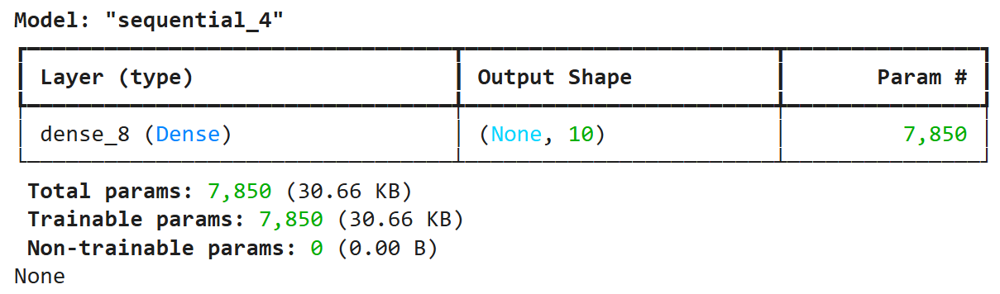

```py
# Обучаем модель
H = model.fit(X_train, y_train, validation_split=0.1, epochs=50)

# вывод графика функции ошибки по эпохам
plt.plot(H.history['loss'])
plt.plot(H.history['val_loss'])
plt.grid()
plt.xlabel('Epochs')
plt.ylabel('loss')
plt.legend(['train_loss', 'val_loss'])
plt.title('Loss by epochs (1 layer, 50 epochs)')
plt.show()
```

Вывод:
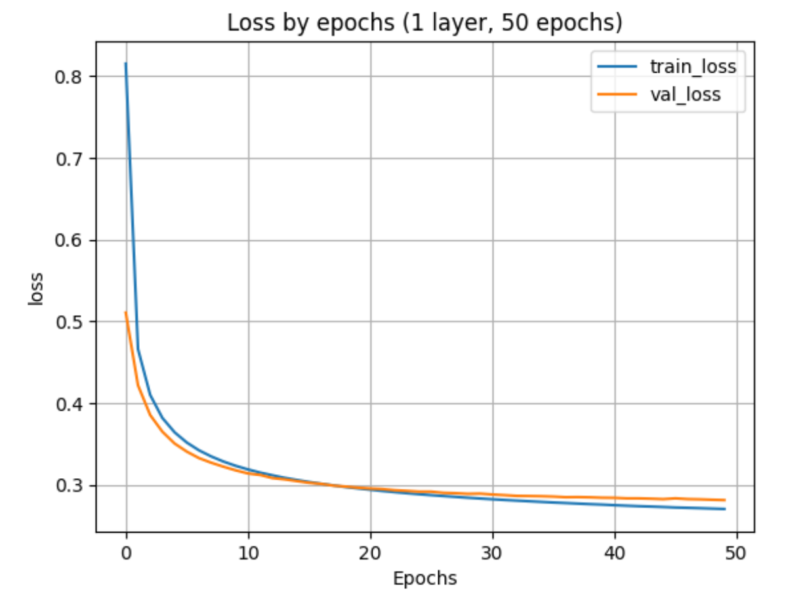

# п.7
Применили обученную модель к тестовым данным. Вывели значение функции ошибки и значение метрики качества классификации на тестовых данных.

```py
# Оценка качества работы модели на тестовых данных
scores = model.evaluate(X_test, y_test)
print('Loss on test data:', scores[0])
print('Accuracy on test data:', scores[1])

Вывод:
Loss on test data: 0.28874462842941284
Accuracy on test data: 0.9253000020980835
```

# п.8
- Добавили в модель один скрытый слой и провели обучение и тестирование (повторили п. 6–7) при 100, 300 и 500 нейронах в скрытом слое. 
- По метрике качества классификации на тестовых данных выбрали наилучшее количество нейронов в скрытом слое. В качестве функции активации нейронов в скрытом слое использовали функцию sigmoid.

_При 100 нейронах:_
```py
model_1h100 = Sequential()
# скрытый слой
model_1h100.add(Dense(units=100, input_dim=num_pixels, activation='sigmoid'))
# выходной слой
model_1h100.add(Dense(units=num_classes, activation='softmax'))
# компиляция
model_1h100.compile(loss='categorical_crossentropy',
                    optimizer='sgd',
                    metrics=['accuracy'])
# вывод архитектуры
print(model_1h100.summary())
# обучение
H100 = model_1h100.fit(X_train, y_train, validation_split=0.1, epochs=50)
# оценка на тестовых данных
scores_100 = model_1h100.evaluate(X_test, y_test)
print('=== 100 нейронов ===')
print('Loss on test data:', scores_100[0])
print('Accuracy on test data:', scores_100[1])
```
Вывод:
Loss on test data: 0.19879719614982605
Accuracy on test data: 0.9456999897956848

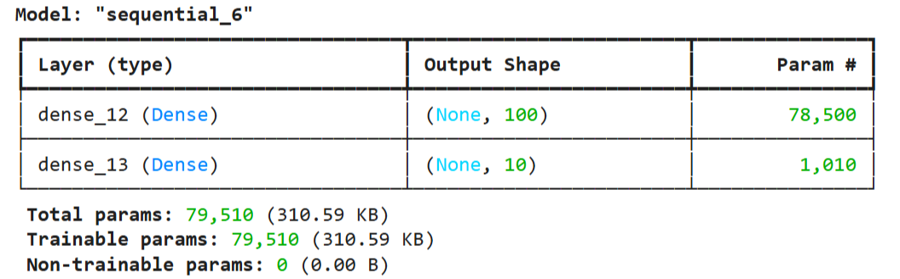


_При 300 нейронах:_
```py
model_1h300 = Sequential()

model_1h300.add(Dense(units=300, input_dim=num_pixels, activation='sigmoid'))
model_1h300.add(Dense(units=num_classes, activation='softmax'))

model_1h300.compile(loss='categorical_crossentropy',
                    optimizer='sgd',
                    metrics=['accuracy'])

print(model_1h300.summary())

H300 = model_1h300.fit(X_train, y_train, validation_split=0.1, epochs=50)

scores_300 = model_1h300.evaluate(X_test, y_test)
print('=== 300 нейронов ===')
print('Loss on test data:', scores_300[0])
print('Accuracy on test data:', scores_300[1])
```

Вывод:
Loss on test data: 0.2270200401544571
Accuracy on test data: 0.9388999938964844

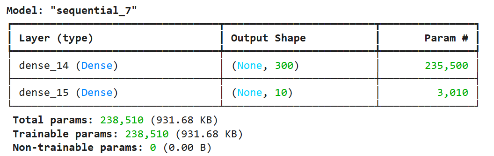

_При 500 нейронах:_
```py
model_1h500 = Sequential()

model_1h500.add(Dense(units=500, input_dim=num_pixels, activation='sigmoid'))
model_1h500.add(Dense(units=num_classes, activation='softmax'))

model_1h500.compile(loss='categorical_crossentropy',
                    optimizer='sgd',
                    metrics=['accuracy'])

print(model_1h500.summary())

H500 = model_1h500.fit(X_train, y_train, validation_split=0.1, epochs=50)

scores_500 = model_1h500.evaluate(X_test, y_test)
print('=== 500 нейронов ===')
print('Loss on test data:', scores_500[0])
print('Accuracy on test data:', scores_500[1])
```

Вывод:
Loss on test data: 0.24608056247234344
Accuracy on test data: 0.9348999857902527
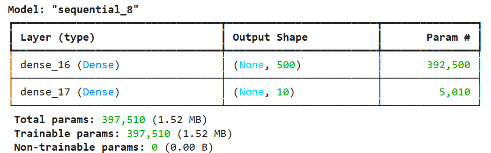

_Графики_
<p align="center">
    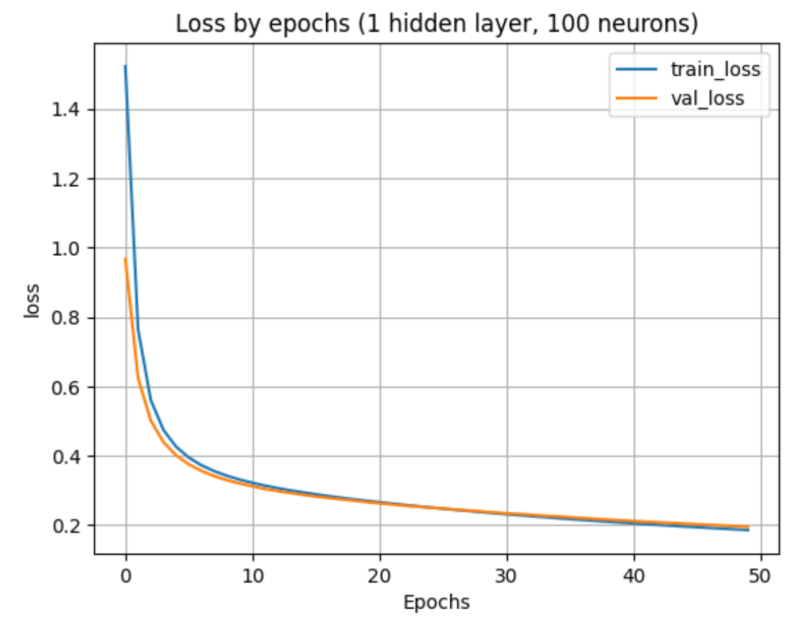
    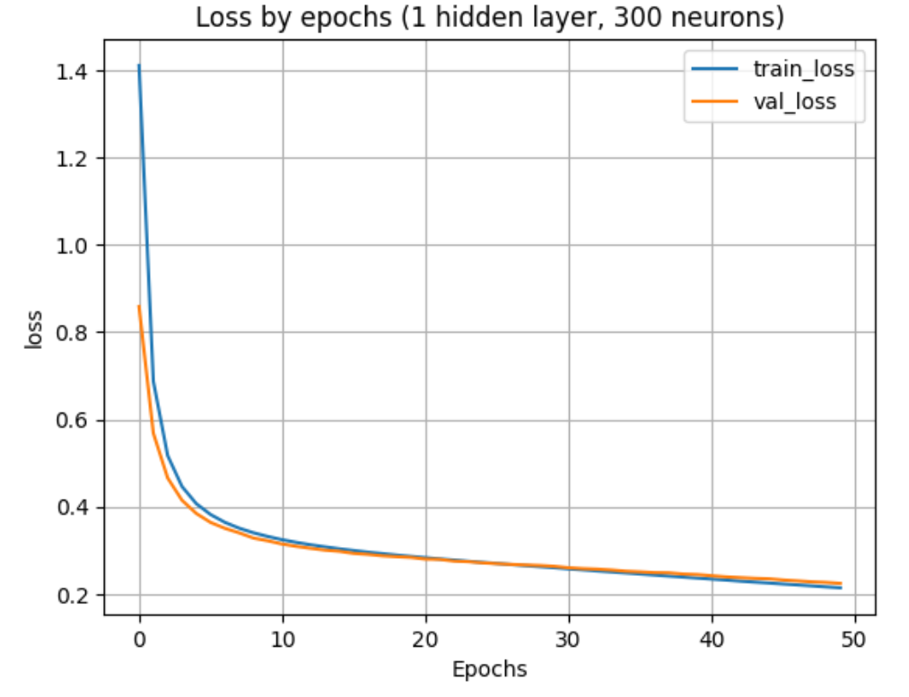
    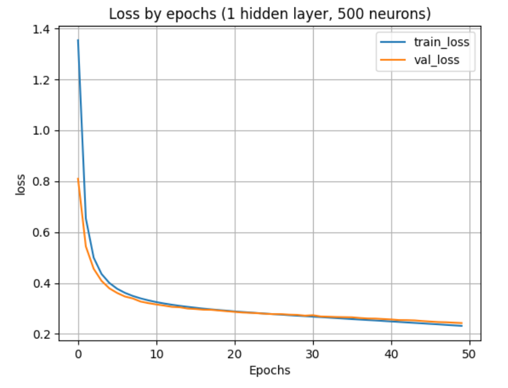
</p>

__Сравнение:__
_100 нейронов:_ accuracy = 0.9457
_300 нейронов:_ accuracy = 0.9389
_500 нейронов:_ accuracy = 0.9349

__Вывод:__ Лучшее количество нейронов: 100


# п.9
Добавили в наилучшую архитектуру, определенную в п. 8, второй скрытый слой и провели обучение и тестирование  (повторили п. 6–7) при 50 и 100 нейронах во втором скрытом слое. В качестве функции активации нейронов в скрытом слое использовали функцию sigmoid.

_При 100 + 50 нейронов:_
```py
model_2h100_50 = Sequential()

# первый скрытый слой (100 нейронов)
model_2h100_50.add(Dense(units=100, input_dim=num_pixels, activation='sigmoid'))

# второй скрытый слой (50 нейронов)
model_2h100_50.add(Dense(units=50, activation='sigmoid'))

# выходной слой
model_2h100_50.add(Dense(units=num_classes, activation='softmax'))

# компиляция
model_2h100_50.compile(loss='categorical_crossentropy',
                        optimizer='sgd',
                        metrics=['accuracy'])

# вывод архитектуры
print(model_2h100_50.summary())

# обучение (повторяем п. 6)
H_2h100_50 = model_2h100_50.fit(X_train, y_train,
                                  validation_split=0.1,
                                  epochs=50)

# оценка на тесте (повторяем п. 7)
scores_2h100_50 = model_2h100_50.evaluate(X_test, y_test)
print('=== 100 + 50 нейронов ===')
print('Loss on test data:', scores_2h100_50[0])
print('Accuracy on test data:', scores_2h100_50[1])
```
Вывод:
Loss on test data: 0.20075832307338715
Accuracy on test data: 0.9433000087738037

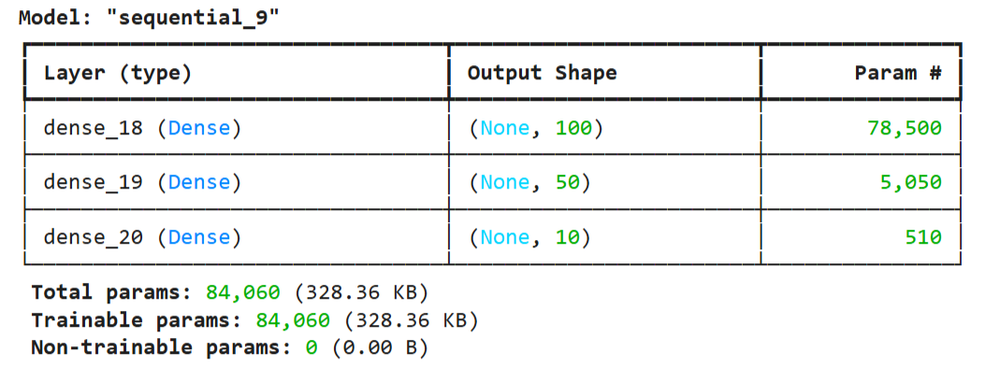


_При 100 + 100 нейронов:_
```py
model_2h100_100 = Sequential()

# первый скрытый слой (100 нейронов)
model_2h100_100.add(Dense(units=100, input_dim=num_pixels, activation='sigmoid'))

# второй скрытый слой (100 нейронов)
model_2h100_100.add(Dense(units=100, activation='sigmoid'))

# выходной слой
model_2h100_100.add(Dense(units=num_classes, activation='softmax'))

# компиляция
model_2h100_100.compile(loss='categorical_crossentropy',
                         optimizer='sgd',
                         metrics=['accuracy'])

print(model_2h100_100.summary())

# обучение
H_2h100_100 = model_2h100_100.fit(X_train, y_train,
                                    validation_split=0.1,
                                    epochs=50)

# оценка на тесте
scores_2h100_100 = model_2h100_100.evaluate(X_test, y_test)
print('=== 100 + 100 нейронов ===')
print('Loss on test data:', scores_2h100_100[0])
print('Accuracy on test data:', scores_2h100_100[1])
```
Вывод:
Loss on test data: 0.20002484321594238
Accuracy on test data: 0.9447000026702881

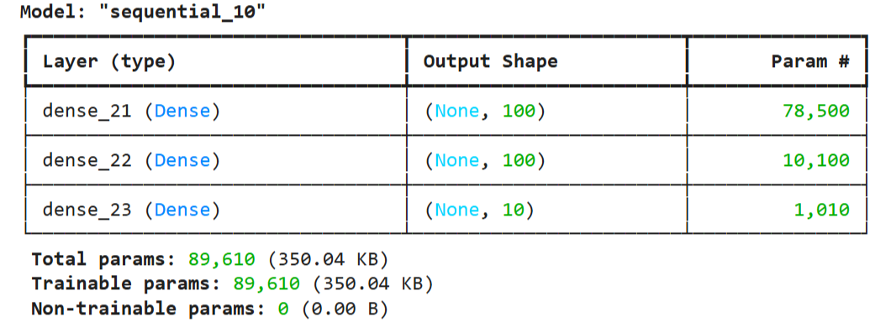

_Графики_
<p align="center">
    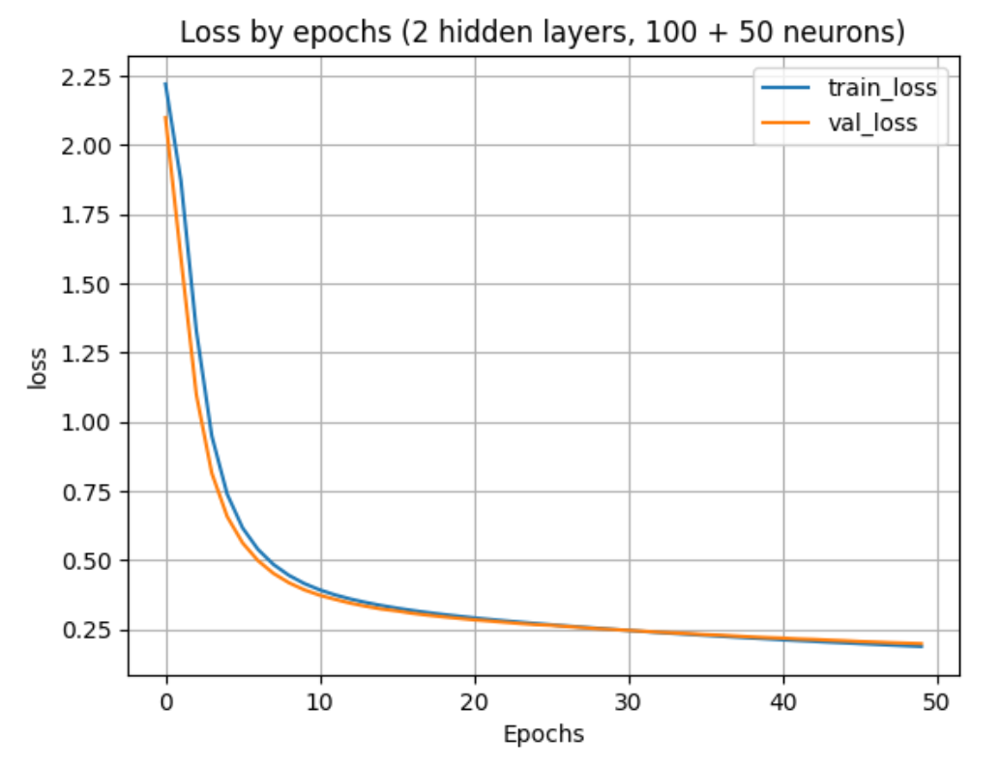
    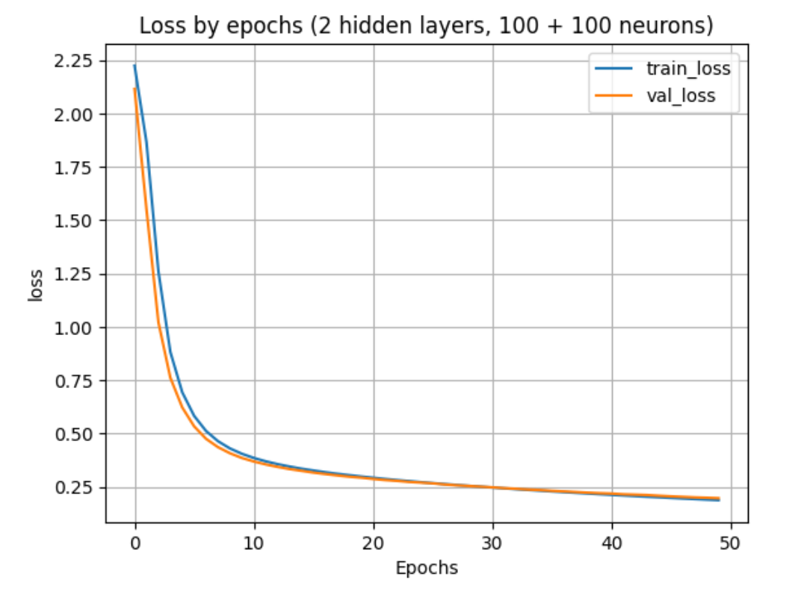
</p>

__Сравнение:__
_100 + 50 нейронов:_ accuracy = 0.9433
_100 + 100 нейронов:_ accuracy = 0.9447

__Вывод:__ Из двух моделей с двумя скрытыми слоями лучший результат показала модель с 100 нейронами во втором слое, модель с 50 нейронами — чуть хуже.


# п.10
Результаты исследования архитектуры нейронной сети:

| Количество скрытых слоёв | Количество нейронов в первом скрытом слое | Количество нейронов во втором скрытом слое | Значение метрики качества классификации |
|:---:|:---:|:---:|:---:|
| 0 | - | - | 0.9253 |
| 1 | 100 | - | 0.9457 |
| 1 | 300 | - | 0.9389 |
| 1 | 500 | - | 0.9349 |
| 2 | 100 | 50 | 0.9433 |
| 2 | 100 | 100 | 0.9447 |

__Вывод:__ Наилучший результат показала однослойная сеть с 1 скрытым слоем на 100 нейронов (accuracy = 0.9457). - - Однослойная сеть без скрытых слоёв дала 0.9253
- Сети с 300 и 500 нейронами — 0.9389 и 0.9349
- Модели с двумя скрытыми слоями — 0.9433 и 0.9447. 
Добавление второго слоя не улучшило качество, поэтому наилучшей выбрана архитектура 1 скрытый слой: 100 нейронов.


# п.11
Сохранили наилучшую нейронную сеть на диск.
```py
model_1h100.save('best_model_1h100.keras')
```
# п.12
Для нейронной сети наилучшей архитектуры вывели два тестовых изображения, истинные метки и результат распознавания изображений.

_Изображение №1_
```py
n = 0
result = model_1h100.predict(X_test[n:n+1])
print('NN output:', result)

plt.imshow(X_test[n].reshape(28,28), cmap=plt.get_cmap('gray'))
plt.show()
print('Real mark: ', str(np.argmax(y_test[n])))
print('NN answer: ', str(np.argmax(result)))
print('-' * 50)
```
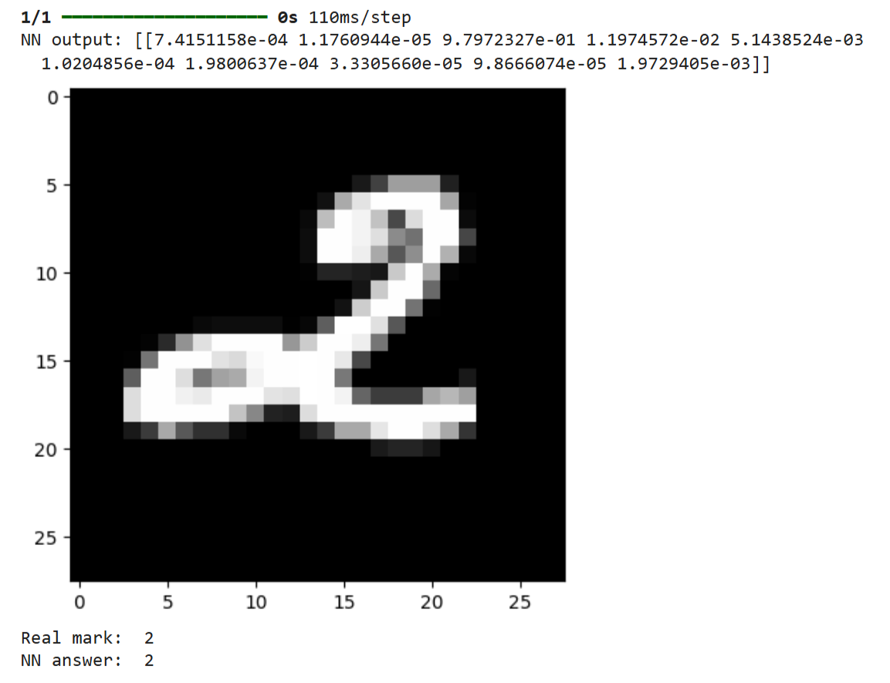

_Изображение №2_
```py
n = 3
result = model_1h100.predict(X_test[n:n+1])
print('NN output:', result)

plt.imshow(X_test[n].reshape(28,28), cmap=plt.get_cmap('gray'))
plt.show()
print('Real mark: ', str(np.argmax(y_test[n])))
print('NN answer: ', str(np.argmax(result)))
```

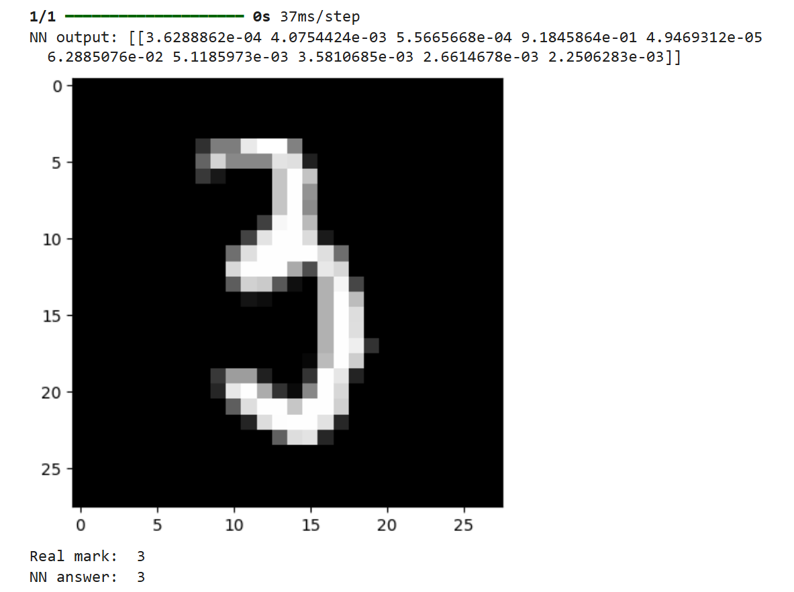

# п.13
Cоздали собственное изображение рукописной цифры, подобное представленным в наборе MNIST(24 mod 10 = 4).
Загрузили, предобраболи и подали на вход обученной нейронной сети собственные изображения.
Вывели изображения и результаты распознавания.

```py
from PIL import Image

# --- загрузка ---
file_data = Image.open('test.png')
file_data = file_data.convert('L')
test_img = np.array(file_data)
print('Shape of loaded image:', test_img.shape)

# --- вывод ---
plt.imshow(test_img, cmap=plt.get_cmap('gray'))
plt.title('My handwritten digit')
plt.axis('off')
plt.show()

# --- предобработка ---
test_img_norm = test_img / 255
test_img_flat = test_img_norm.reshape(1, num_pixels)
print('Shape for NN input:', test_img_flat.shape)

# --- распознавание ---
result = model_1h100.predict(test_img_flat, verbose=0)
print('NN output:', result)
print('NN answer: ', str(np.argmax(result)))
```

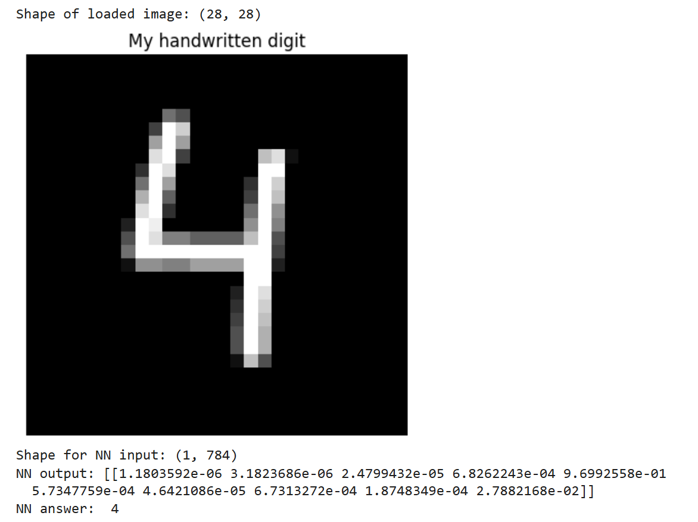

# п.14
 _Цифра 4:_
```py
from PIL import Image

file_data = Image.open('test_rotated.png')
file_data = file_data.convert('L')   # перевод в градации серого
test_img_rot = np.array(file_data)
print('Shape of loaded rotated image:', test_img_rot.shape)

# вывод повёрнутого изображения
plt.imshow(test_img_rot, cmap=plt.get_cmap('gray'))
plt.title('My digit rotated 90 degrees')
plt.axis('off')
plt.show()

# предобработка
test_img_rot = test_img_rot / 255
test_img_rot = test_img_rot.reshape(1, num_pixels)
print('Shape for NN input:', test_img_rot.shape)

# распознавание
result_rot = model_1h100.predict(test_img_rot, verbose=0)
print('NN output:', result_rot)
print('I think it\'s ', np.argmax(result_rot))
```

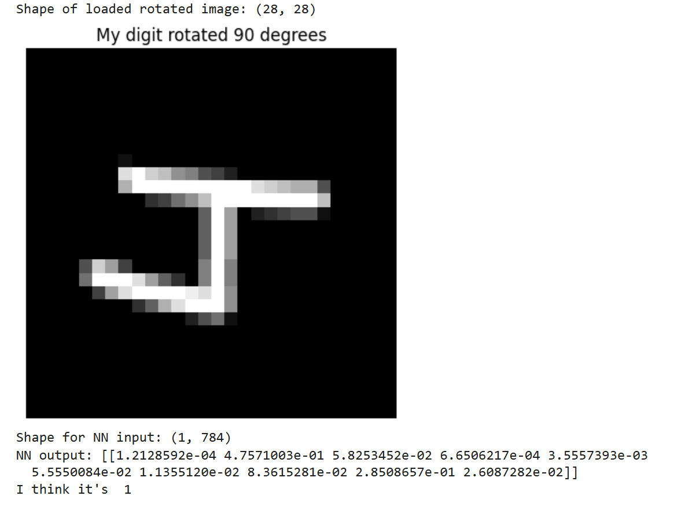


 _Цифра 5:_
```py
from PIL import Image

file_data = Image.open('test_rotated_2.png')
file_data = file_data.convert('L')   # перевод в градации серого
test_img_rot2 = np.array(file_data)
print('Shape of loaded rotated image:', test_img_rot2.shape)

# вывод изображения
plt.imshow(test_img_rot2, cmap=plt.get_cmap('gray'))
plt.title('My digit rotated (2nd copy)')
plt.axis('off')
plt.show()

# предобработка
test_img_rot2 = test_img_rot2 / 255
test_img_rot2 = test_img_rot2.reshape(1, num_pixels)
print('Shape for NN input:', test_img_rot2.shape)

# распознавание
result_rot2 = model_1h100.predict(test_img_rot2, verbose=0)
print('NN output:', result_rot2)
print('I think it\'s ', np.argmax(result_rot2))
```

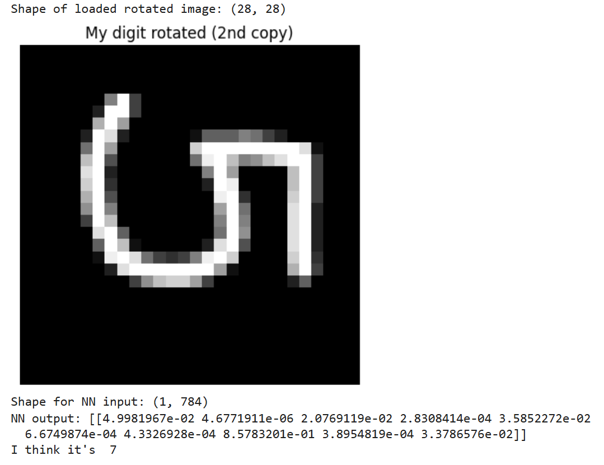

__Вывод:__ Обученная модель правильно распознала только прямое изображение цифры 4, а повёрнутые цифры на 90° копии — неверно. Это значит, что модель не умеет распознавать повёрнутые цифры, потому что при обучении она видела только прямые изображения и не встречала поворотов.