# Лабораторная работа №2 «Обнаружение аномалий»

**Бригада:** №7  

## Подготовка среды
### п.1. 
Определить свой набор данных по таблице исходя из номера бригады (Бриагада 7):
__Вариант (N):__  7 mod 3 = 1
__Название набора данных (name):__ Letter

### п.2. 
Подготовили программную среду Google Colaboratory для выполнения лабораторной работы

```py
from google.colab import drive
drive.mount('/content/drive')
```

## Задание 1.

### Пункт 1.

В среде Google Colab создали новый блокнот (notebook). Импортировали необходимые для работы библиотеки и модули.

```py
import os
os.chdir('/content/drive/MyDrive/Colab Notebooks/is_lab2')

# импорт модулей
import numpy as np
import lab02_lib as lib
```

### Пункт 2.

Сгенерировали индивидуальный набор двумерных данных в пространстве признаков с координатами центра (7, 7) и вывела полученные данные на рисунок и в консоль.

```python
data = lib.datagen(7, 7, 1000, 2)

# вывод данных и размерности
print('Исходные данные:')
print(data)
print('Размерность данных:')
print(data.shape)
```

Вывод:
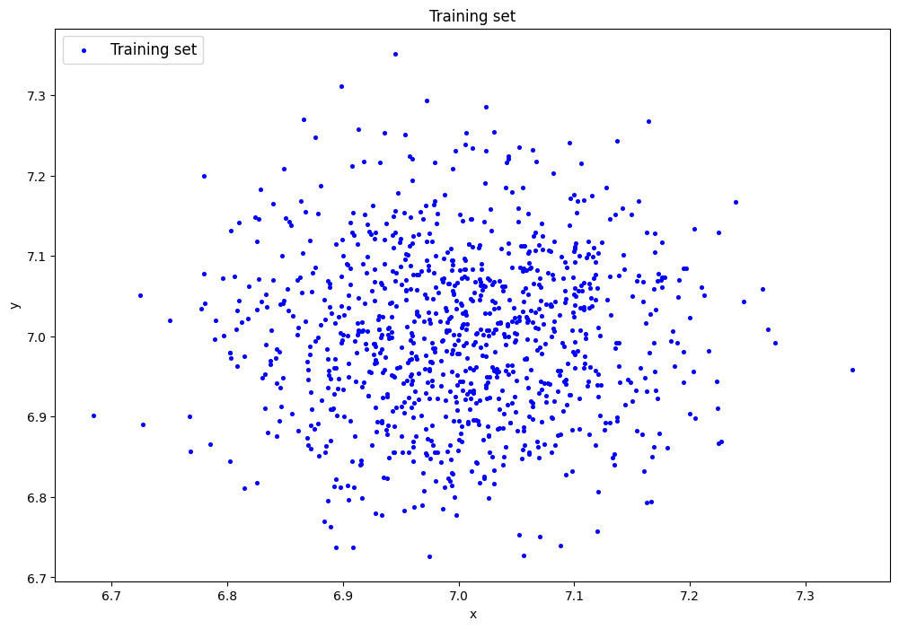

```text
Исходные данные:
[[6.99852557 7.06675895]
 [7.22722828 6.86896745]
 [6.92847739 6.88132416]
 ...
 [7.03133765 6.98032662]
 [7.05210651 7.02414793]
 [6.97160742 7.16271829]]
Размерность данных:
(1000, 2)
```

### Пункт 3.

Создали автоколировщик AE1 и задали один скрытый слой с одним нейроном. Задали 1000 эпох и `patience = 300`.

```py
# обучение AE1
patience = 300
ae1_trained, IRE1, IREth1 = lib.create_fit_save_ae(data,'out/AE1.h5','out/AE1_ire_th.txt', 1000, True, patience)
```

Вывод:

```text
Задать архитектуру автокодировщиков или использовать архитектуру по умолчанию? (1/2): 1
Задайте количество скрытых слоёв (нечетное число) : 1
Задайте архитектуру скрытых слоёв автокодировщика, например, в виде 3 1 3 : 1
Epoch 1/1000
1/1 ━━━━━━━━━━━━━━━━━━━━ 1s 1s/step - loss: 52.3517
Epoch 2/1000
1/1 ━━━━━━━━━━━━━━━━━━━━ 0s 49ms/step - loss: 52.3213
.
.
.
Epoch 999/1000
1/1 ━━━━━━━━━━━━━━━━━━━━ 0s 76ms/step - loss: 26.6078
Epoch 1000/1000
1/1 ━━━━━━━━━━━━━━━━━━━━ 0s 108ms/step - loss: 26.5892
Epoch 1000/1000
 - loss: 26.5892
1/1 ━━━━━━━━━━━━━━━━━━━━ 0s 136ms/step - loss: 26.5892
Restoring model weights from the end of the best epoch: 1000.
32/32 ━━━━━━━━━━━━━━━━━━━━ 0s 3ms/step
WARNING:absl:You are saving your model as an HDF5 file via `model.save()` or `keras.saving.save_model(model)`. This file format is considered legacy. We recommend using instead the native Keras format, e.g. `model.save('my_model.keras')` or `keras.saving.save_model(model, 'my_model.keras')`. 
```

### Пункт 4.

После 1000 эпох получили __MSE_stop__ = 26.5892.Высокое значение ошибки указывает на то, что автокодировщик с низкой точностью восстанавливает входные данные, то есть качество его обучения недостаточное.  

```python
# Построение графика ошибки реконструкции
lib.ire_plot('training', IRE1, IREth1, 'AE1')
```

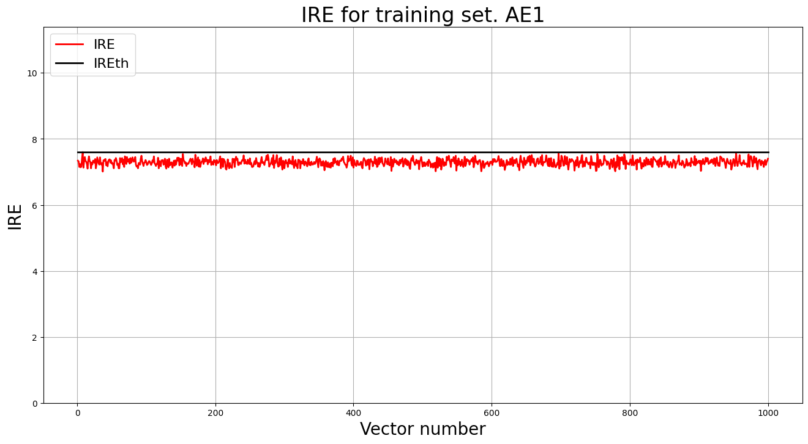

_Порог обнаружения аномалий:_ 7.600
_Значение MSE на момент завершения обучения:_ 26.5892

### Пункт 5.

Создали второй автокодировщик AE2 с увеличенным числом эпох: максимум 3000, `patience = 300`. Архитектура по умолчанию: 5 скрытых слоёв с числом нейронов 3, 2, 1, 2, 3. 

```python
# обучение AE2
ae2_trained, IRE2, IREth2 = lib.create_fit_save_ae(data,'out/AE2.h5','out/AE2_ire_th.txt', 3000, True, patience)
```
Вывод:
```text
Streaming output truncated to the last 5000 lines.
1/1 ━━━━━━━━━━━━━━━━━━━━ 0s 56ms/step - loss: 17.9369
Epoch 424/3000
1/1 ━━━━━━━━━━━━━━━━━━━━ 0s 57ms/step - loss: 17.8980
Epoch 425/3000
1/1 ━━━━━━━━━━━━━━━━━━━━ 0s 61ms/step - loss: 17.8592
.
.
.
Epoch 2918/3000
1/1 ━━━━━━━━━━━━━━━━━━━━ 0s 65ms/step - loss: 0.0120
Epoch 2918: early stopping
Restoring model weights from the end of the best epoch: 2618.
32/32 ━━━━━━━━━━━━━━━━━━━━ 0s 5ms/step
WARNING:absl:You are saving your model as an HDF5 file via `model.save()` or `keras.saving.save_model(model)`. This file format is considered legacy. We recommend using instead the native Keras format, e.g. `model.save('my_model.keras')` or `keras.saving.save_model(model, 'my_model.keras')`. 
```

### Пункт 6.

Обучение остановилось на 2918-й эпохе. 
_Значение MSE на момент завершения обучения:_ 0.0120

Библиотека восстановила веса 2618-й эпохи.
_Порог обнаружения аномалий:_ 0.4900

```py
lib.ire_plot('training', IRE2, IREth2, 'AE2')
```

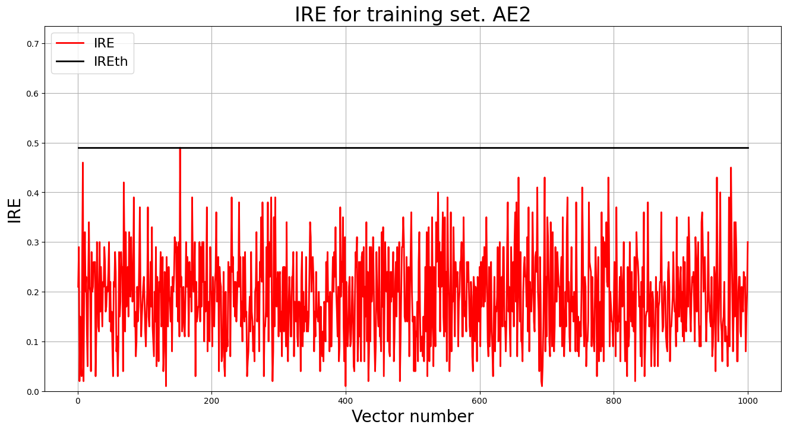


### Пункт 7.

EDCA оценивает, насколько область нормы автокодировщика соответствует обучающим данным. Для расчёта пространство разбивается на ячейки (numb_square = 20). Идеальные значения показателей: 
- Excess = 0, 
- Deficit = 0, 
- Coating = 1, 
- Approx = 1.

__AE1:__

```py
# построение областей покрытия и границ классов
# расчет характеристик качества обучения
numb_square = 20
xx, yy, Z1 = lib.square_calc(numb_square, data, ae1_trained, IREth1, '1', True)
```

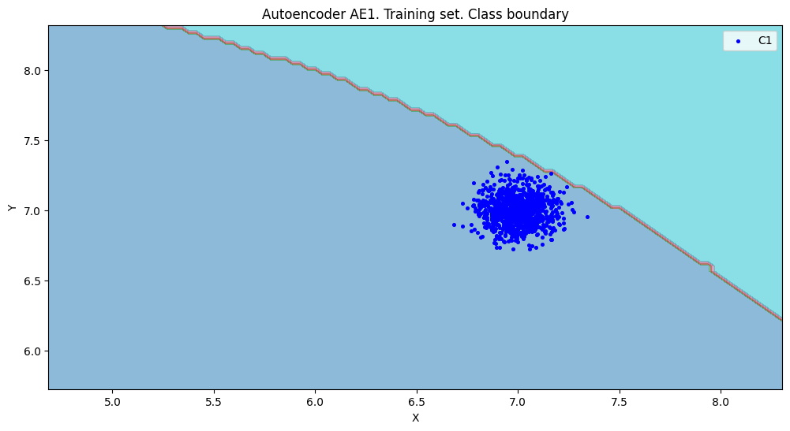

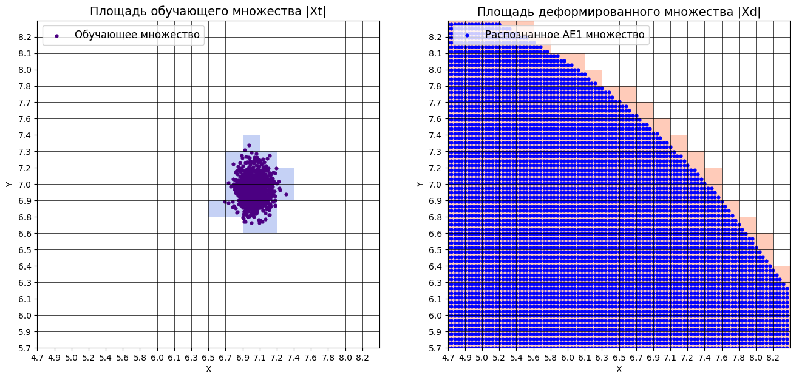

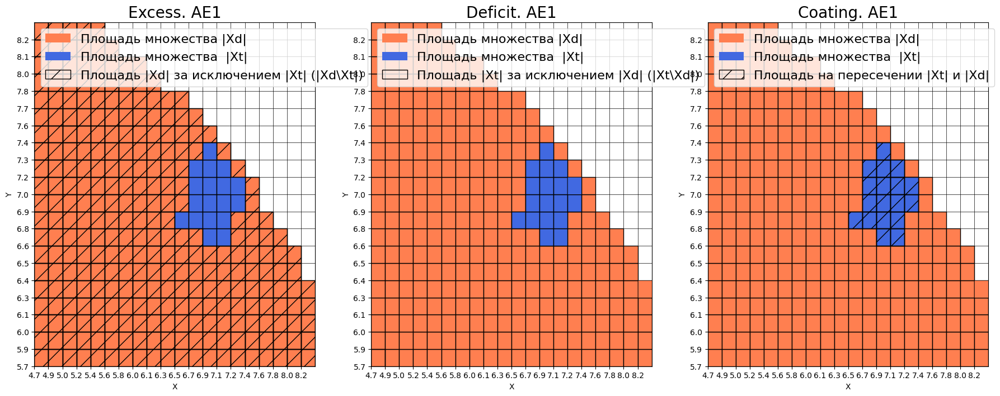

```text
amount:  18
amount_ae:  298

Оценка качества AE1
IDEAL = 0. Excess:  15.555555555555555
IDEAL = 0. Deficit:  0.0
IDEAL = 1. Coating:  1.0
summa:  1.0
IDEAL = 1. Extrapolation precision (Approx):  0.06040268456375839
```


__AE2:__

```py
# построение областей покрытия и границ классов
# расчет характеристик качества обучения
numb_square = 20
xx, yy, Z2 = lib.square_calc(numb_square, data, ae2_trained, IREth2, '2', True)
```
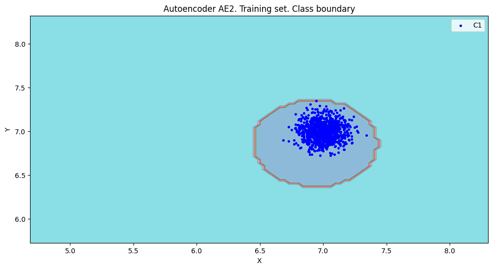
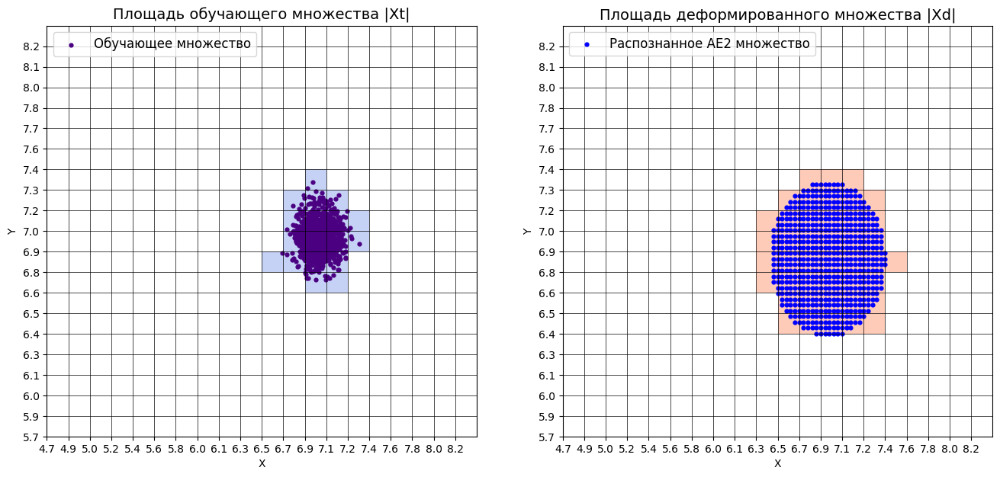
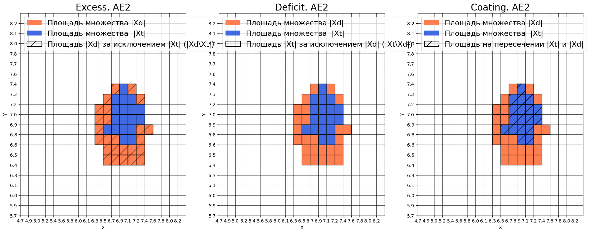

```text
amount:  18
amount_ae:  43

Оценка качества AE2
IDEAL = 0. Excess:  1.3888888888888888
IDEAL = 0. Deficit:  0.0
IDEAL = 1. Coating:  1.0
summa:  1.0
IDEAL = 1. Extrapolation precision (Approx):  0.4186046511627907
```

_Сравнение двух автокодировщиков:_
```py
# сравнение характеристик качества обучения и областей аппроксимации
lib.plot2in1(data, xx, yy, Z1, Z2)
```
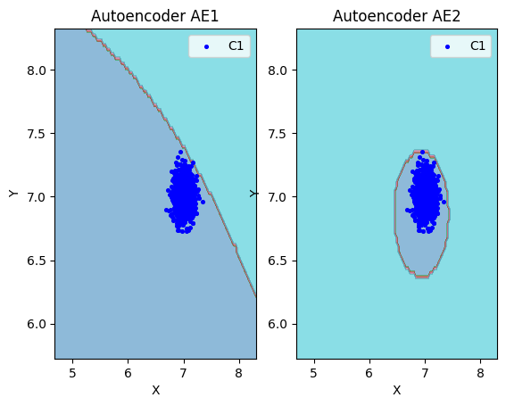

| Модель | Обучающих ячеек | Распознанных ячеек | Excess | Deficit | Coating | Approx |
|---|---:|---:|---:|---:|---:|---:|
| AE1 | 18 | 298 | 15.5556 | 0 | 1 | 0.0604 |
| AE2 | 18 | 43 | 1.3889 | 0 | 1 | 0.4186 |

__Вывод:__ AE1 недостаточно точно описывает область обучающих данных: высокое значение Excess = 15.56 указывает на большую лишнюю область нормы и риск пропуска аномалий. AE2 формирует более компактную область: Excess = 1.39, Approx = 0.4186. Поэтому AE2 лучше подходит для обнаружения аномалий.

### Пункт 8.

Область нормы AE2 достаточно близка к обучающим данным, поэтому модель использована для дальнейшего тестирования без дополнительной настройки.

### Пункт 9.

По графикам из пункта 7 выбраны четыре точки: (6; 7), (6; 6,5), (5,5; 7,5), (7; 6). Они не входят в обучающую выборку, находятся внутри области нормы AE1, но за пределами области нормы AE2.

```text
[[6.0  7.0 ]
 [6.0  6.5]
 [5.5 7.5]
 [7.0  6.0 ]]
```

```py
# загрузка тестового набора
data_test = np.loadtxt('data_test.txt', dtype=float)
```

### Пункт 10.

Применили обученные автокодировщики AE1 и AE2 к тестовым данным и вывели значения ошибки реконструкции для каждого элемента тестовой выборки относительно порога на график и в консоль.

```py
# тестирование АE1
predicted_labels1, ire1 = lib.predict_ae(ae1_trained, data_test, IREth1)
lib.anomaly_detection_ae(predicted_labels1, ire1, IREth1)
lib.ire_plot('test', ire1, IREth1, 'AE1')
```

Вывод:
```text
Аномалий не обнаружено
```
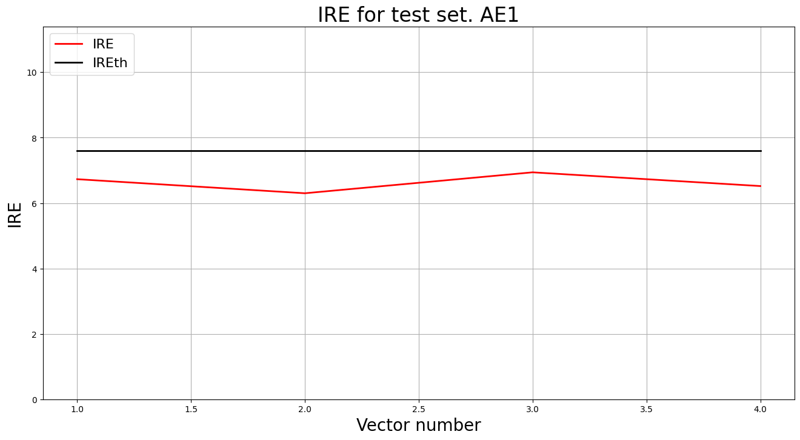

```text
i         Labels    IRE       IREth     
0         [1.]      [0.95]    0.49      
1         [1.]      [1.]      0.49      
2         [1.]      [1.57]    0.49      
3         [1.]      [0.87]    0.49      
Обнаружено  4.0  аномалий
```
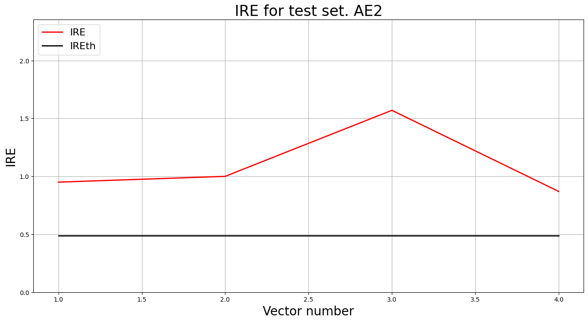


AE1 не обнаружил аномалий, AE2 обнаружил 4 из 4 специально подобранных точек.

### Пункт 11.

Визуализировали элементы обучающей и тестовой выборки в областях пространства признаков, распознаваемых автокодировщиками AE1 и AE2.

```py
# построение областей аппроксимации и точек тестового набора
lib.plot2in1_anomaly(data, xx, yy, Z1, Z2, data_test)
```

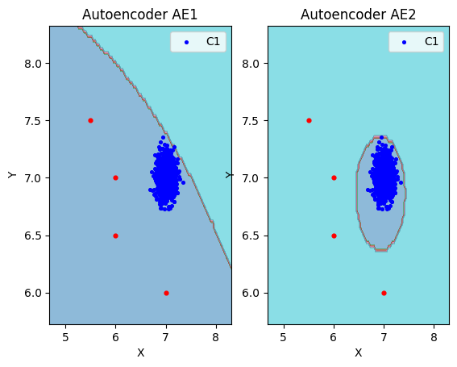

На графиках все четыре тестовые точки находятся внутри области нормы AE1 и за пределами области нормы AE2. Поэтому AE1 пропустил все аномалии, а AE2 обнаружил их, точнее отделив нормальные данные от аномальных.

### Пункт 12.

| Модель | Количество скрытых слоёв | Нейронов | Выполнено эпох | MSE_stop | Порог IRE | Excess | Approx | Аномалии |
|---|---:|---|---:|---:|---:|---:|---:|---|
| AE1 | 1 | 1 | 1000 | 26,5892 | ≈ 7,6* | 15,5556 | 0,0604 | 0 из 4 |
| AE2 | 5 | 3, 2, 1, 2, 3 | 2918 | 0,0120** | 0,49 | 1,3889 | 0,4186 | 4 из 4 |

| | Количество скрытых слоёв | Количество нейронов в скрытых слоях | Количество эпох обучения | Ошибка MSE_stop | Порог ошибки реконструкции | Значение показателя Excess | Значение показателя Approx | Количество обнаруженных аномалий |
|:-:|:-:|:-:|:-:|:-:|:-:|:-:|:-:|:-:|
| AE1 | 1 | 1 | 1000 | 26.5892 | 7.60 | 15.5556 | 0.0604 | 0 из 4 |
| AE2 | 5 | 3, 2, 1, 2, 3 | 3000 (ранняя остановка на 2918-й) | 0.0120 | 0.49 | 1.3889 | 0.4186 | 4 из 4 |

### Пункт 13. Вывод.

1. Данные для обучения должны содержать нормальные примеры и достаточно полно описывать их изменчивость. В работе использованы 1000 точек с центром около (7, 7). Выбросы нежелательны, поскольку могут завышать порог обнаружения аномалий.
2. Архитектура автокодировщика должна позволять точно восстанавливать данные. В нашем эксперименте AE1 с одним скрытым нейроном показал худший результат, чем AE2 с пятью скрытыми слоями.
3. Количество эпох должно быть достаточным для обучения. AE1 после 1000 эпох сохранял большую ошибку. AE2 обучался до ранней остановки на 2918-й эпохе и восстанавливал данные значительно точнее.
4. MSE_stop следует оценивать вместе с другими показателями качества. У AE1 значение 26,5892 свидетельствует о плохом восстановлении данных. У AE2 ошибка снизилась до 0,0120, однако одной низкой MSE недостаточно для оценки обнаружения аномалий.
5. Порог ошибки реконструкции определяется по максимальной ошибке обучающей выборки. У AE1 он составил 7,60, у AE2 — 0,49. AE1 пропустил все четыре выбранные аномалии, тогда как AE2 обнаружил их.
6. Показатели EDCA должны приближаться к идеальным: Excess и Deficit — к 0, Coating и Approx — к 1. У AE2 Excess снизился с 15,5556 до 1,3889, а Approx вырос с 0,0604 до 0,4186. Поэтому AE2 точнее описывает область обучающих данных, хотя его аппроксимация ещё не идеальна.

---

## Задание 2. Обнаружение аномалий в наборе Letter

### Пункт 1.

По варианту №7 использовали __Letter__ 
В подготовленной выборке каждый пример содержит 32 признака; обучающая выборка состоит из нормальных объектов, тестовая — из аномальных.

### Пункт 2.
Загрузили многомерную обучающую выборку реальных данных letter_train.txt.

```py
train = np.loadtxt('letter_train.txt', dtype=float)
```

### Пункт 3.

Вывели данные в консоль.

```py
print(train.shape)
```

Вывод:
```text
Исходные данные:
[[ 6. 10.  5. ... 10.  2.  7.]
 [ 0.  6.  0. ...  8.  1.  7.]
 [ 4.  7.  5. ...  8.  2.  8.]
 ...
 [ 7. 10. 10. ...  8.  5.  6.]
 [ 7.  7. 10. ...  6.  0.  8.]
 [ 3.  4.  5. ...  9.  5.  5.]]
Размерность данных:
(1500, 32)
```

### Пункт 4 - 8.

Обучили AE3 на нормальных данных. 
```py
# обучение AE3
patience = 5000
ae3_trained, IRE3, IREth3 = lib.create_fit_save_ae(train,'out/AE3.h5','out/AE3_ire_th.txt', 100000, False, patience)
lib.ire_plot('training', IRE3, IREth3, 'AE3')
```

```python
#Загрузка тестовой выборки
letter_test = np.loadtxt('letter_test.txt', dtype=float)
print(letter_test.shape)
```

_1 попытка:_ 7 скрытых слоёв `32 24 16 7 16 24 32` и предел 100 000 эпох.
 __MSE__ ≈ 0.4136, порог __IRE__ = 8.61.

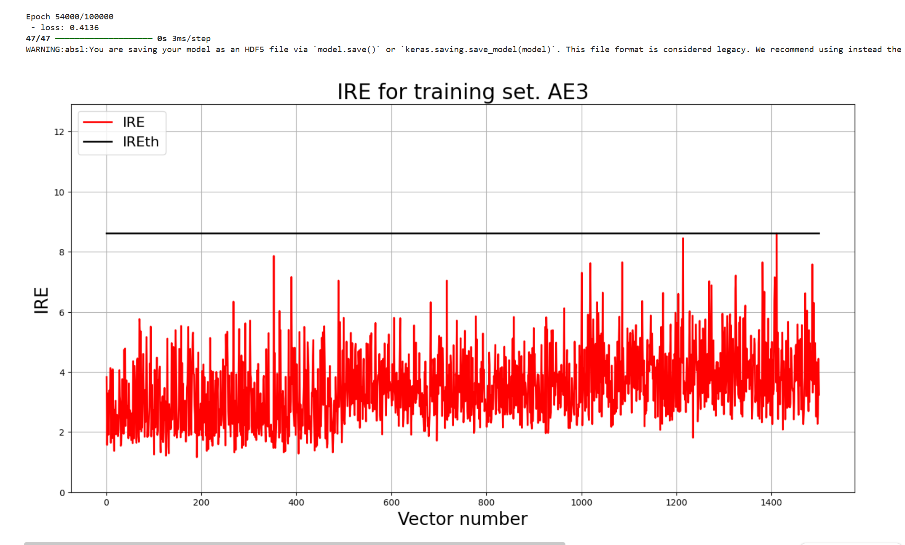

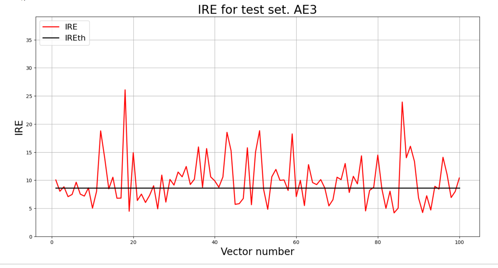

```text 
94        [0.]      [8.42]    8.61      
95        [1.]      [14.08]   8.61      
96        [1.]      [11.02]   8.61      
97        [0.]      [6.91]    8.61      
98        [0.]      [7.99]    8.61      
99        [1.]      [10.39]   8.61      
Обнаружено  56.0  аномалий
```
Размер тестового массива — __(100, 32)__
При пороге `8.61` обнаружено **56 из 100 аномалий (56%)**.


### Пункт 9.

Требуемые __70%__ не были достигнуты, поэтому проверили ещё две модели.

_2 попытка:_ 7 слоёв `32 28 24 16 24 28 32`
__MSE_stop__ = 0.1988, порог __IRE__ = 5.90.

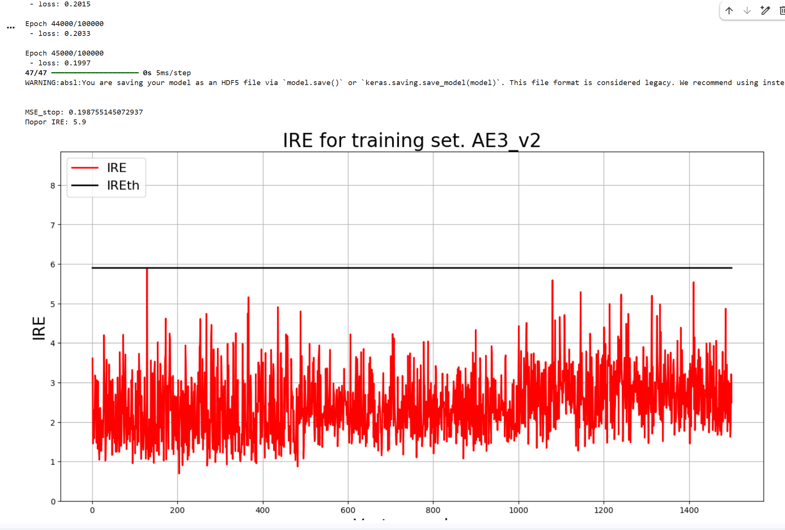

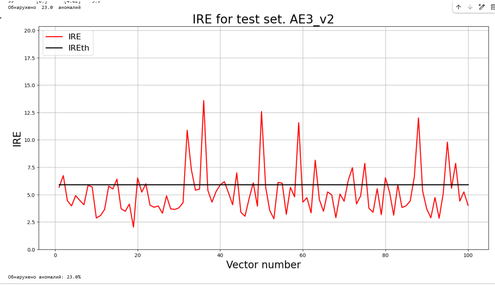

```text
91        [0.]      [4.73]    5.9       
92        [0.]      [2.84]    5.9       
93        [0.]      [5.12]    5.9       
94        [1.]      [9.79]    5.9       
95        [0.]      [5.58]    5.9       
96        [1.]      [7.85]    5.9       
97        [0.]      [4.4]     5.9       
98        [0.]      [5.24]    5.9       
99        [0.]      [4.02]    5.9       
Обнаружено  23.0  аномалий
```

_3 попытка:_ 9 слоёв `48 32 24 16 7 16 24 32 48`; 100 000 эпох, `patience = 5000`, `early_stopping_delta = 0.0001`; 
__MSE_stop__ = 0.2681, порог __IRE__ = 7,34.

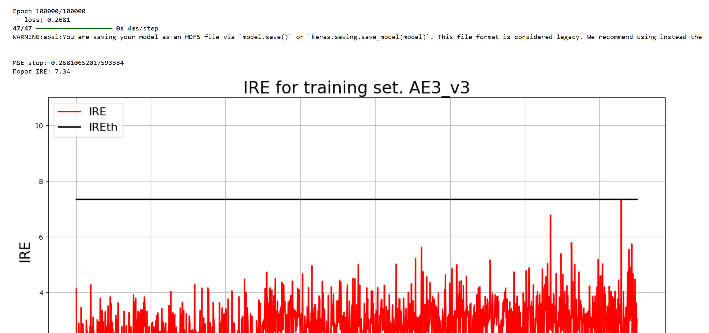

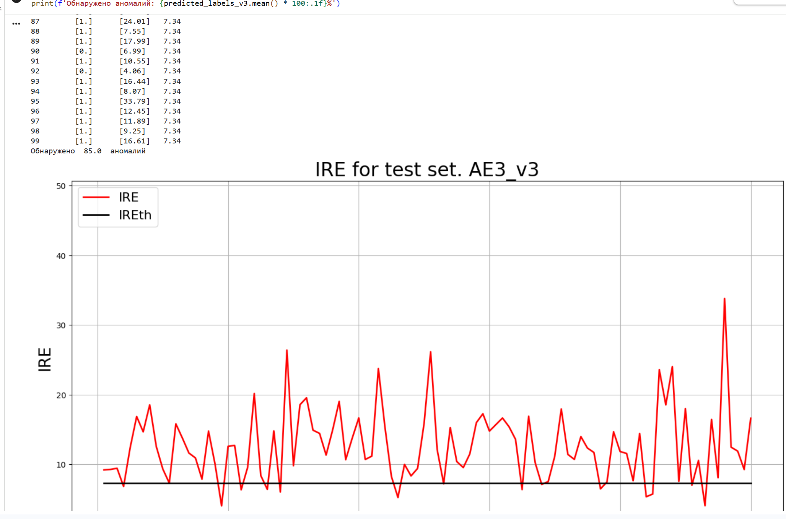
```text
95        [1.]      [33.79]   7.34      
96        [1.]      [12.45]   7.34      
97        [1.]      [11.89]   7.34      
98        [1.]      [9.25]    7.34      
99        [1.]      [16.61]   7.34      
Обнаружено  85.0  аномалий
```

| Попытка | Архитектура скрытых слоёв | MSE_stop | Порог IRE | Обнаружено |
|---|---|---:|---:|---:|
| 1 | `32 24 16 7 16 24 32` | ≈ 0.4136* | 8.61 | 56% |
| 2 | `32 28 24 16 24 28 32` | 0.1988 | 5.90 | 23% |
| **3** | **`48 32 24 16 7 16 24 32 48`** | **0.2681** | **7.34** | **85%** |

__Вывод:__ лучшая — 3 модель, обнаружившая _85 из 100 аномалий_.

### Пункт 10. Итоговая таблица

| Dataset name | Количество скрытых слоёв | Количество нейронов в скрытых слоях | Количество эпох обучения | Ошибка MSE_stop | Порог ошибки реконструкции | % обнаруженных аномалий |
|:-:|:-:|:-:|:-:|:-:|:-:|:-:|
| Letter | 9 | `48 32 24 16 7 16 24 32 48` | 100 000 | 0.2681 | 7,34 | **85%** |

### Пункт 11.
Вывод:
1. **Данные для обучения** должны содержать нормальные примеры и отражать их разнообразие. В работе использованы 1500 примеров Letter с 32 признаками.
2. **Архитектуру** необходимо подбирать экспериментально. Лучший результат показала модель с 9 скрытыми слоями `48 32 24 16 7 16 24 32 48`: она обнаружила 85% аномалий.
3. **Количество эпох** должно обеспечивать достаточное обучение. Лучшая модель обучалась 100 000 эпох. При этом увеличение длительности обучения само по себе не гарантирует улучшения обнаружения.
4. **MSE_stop** нельзя использовать как единственный критерий качества. Вторая модель имела меньшую MSE — 0,1988, но обнаружила только 23% аномалий. Третья при MSE = 0,2681 обнаружила 85%.
5. **Порог реконструкции** определяется максимальной ошибкой обучающей выборки. Для лучшей модели он составил 7,34. При таком пороге обнаружено 85 из 100 аномалий, что превышает требуемые 70%.